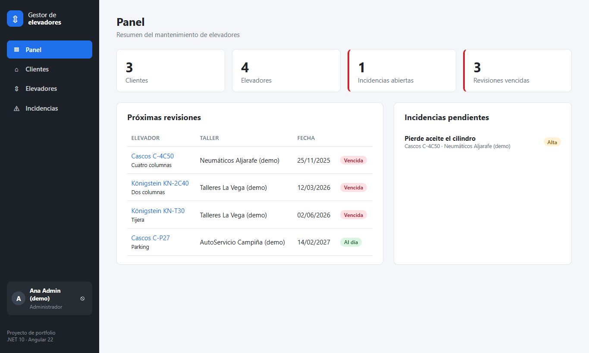
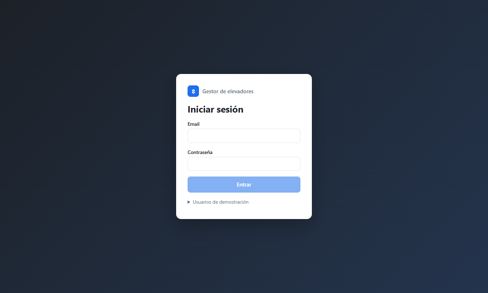
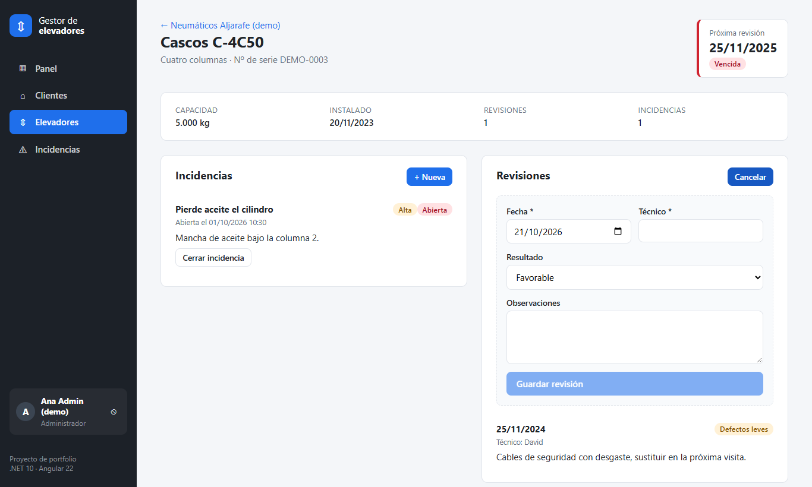
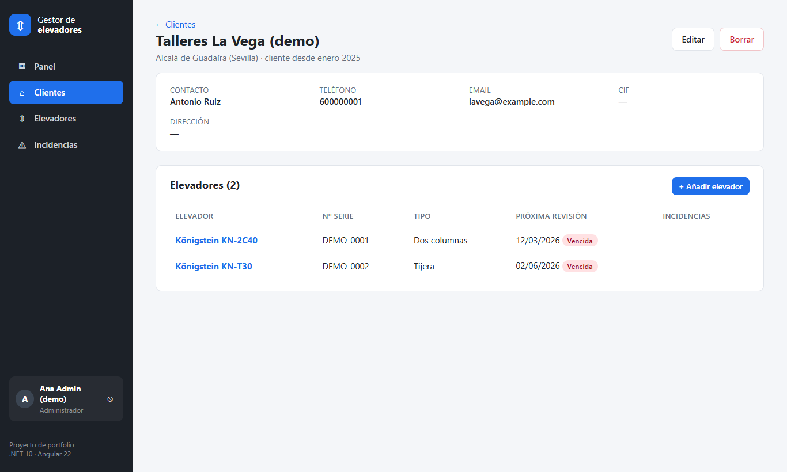
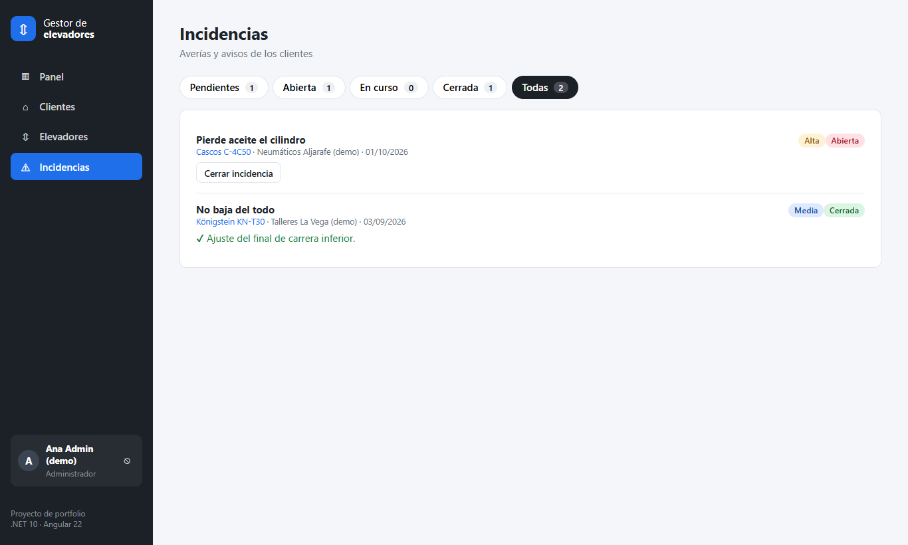
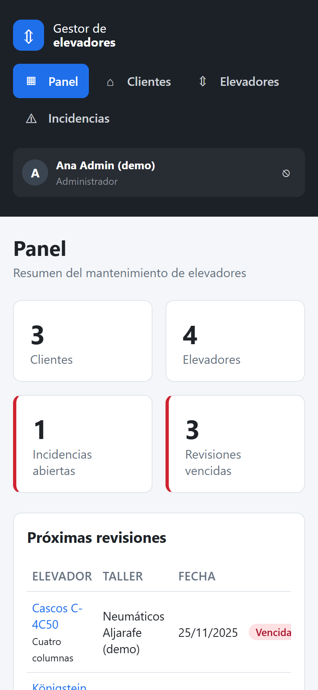
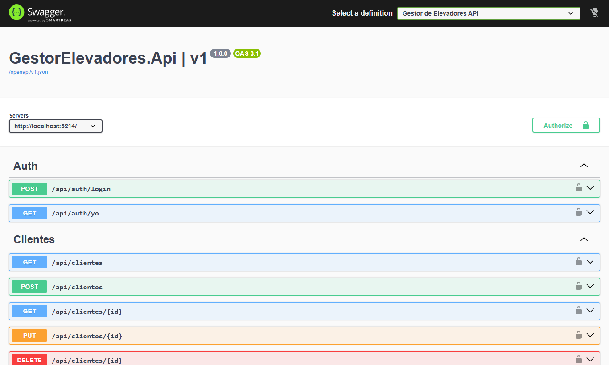

# Gestor de mantenimiento de elevadores

Aplicación web **Full Stack** para que una empresa instaladora lleve el control de los **elevadores de automoción** que monta en talleres: clientes, equipos instalados, **revisiones anuales obligatorias** e **incidencias** (averías).

- **Backend:** .NET 10 · ASP.NET Core Web API · Entity Framework Core
- **Frontend:** Angular 22 (componentes standalone y signals)
- **Seguridad:** JWT con roles

> El proyecto nace de mi experiencia real como electromecánico montando elevadores de dos y cuatro columnas, de tijera y de parking. Resuelve un problema que conozco de primera mano: saber qué equipos tienen la revisión vencida y qué averías están pendientes.



---

## Funcionalidades

- **Panel de control:** clientes, elevadores, incidencias abiertas y revisiones vencidas, más las próximas revisiones y las averías ordenadas por urgencia.
- **Clientes (talleres):** buscador en tiempo real, alta, edición, ficha con sus elevadores y alta de elevadores desde la ficha.
- **Elevadores:** listado ordenado por la próxima revisión, con filtro "solo vencidos". La fecha de la próxima revisión se calcula sola: un año después de la última revisión o de la instalación.
- **Ficha del elevador:**
  - Historial de revisiones con su resultado: favorable, con defectos leves o desfavorable.
  - Incidencias con prioridad y estado.
  - Se pueden abrir y cerrar incidencias (indicando la solución) y registrar revisiones.
- **Incidencias:** vista por estado con contadores (pendientes, abiertas, en curso, cerradas).
- **Inicio de sesión con roles:**
  - El **administrador** gestiona clientes y elevadores.
  - El **técnico** consulta, registra revisiones y abre o cierra incidencias.
- **Diseño adaptado a móvil** y fechas y números en formato español.

## Capturas

| Inicio de sesión | Ficha de elevador |
|---|---|
|  |  |

| Ficha de cliente | Incidencias |
|---|---|
|  |  |

| Móvil | API documentada (Swagger) |
|---|---|
|  |  |

## Tecnologías

| Capa | Tecnología |
|---|---|
| API | .NET 10, ASP.NET Core Web API (controladores), C# 14 |
| Datos | Entity Framework Core 10 con SQLite, migraciones y datos de demostración |
| Seguridad | JWT Bearer, roles, contraseñas con `PasswordHasher` (PBKDF2 con sal) |
| Documentación | OpenAPI y Swagger UI (con botón *Authorize* para probar con token) |
| Frontend | Angular 22: componentes standalone, signals, formularios reactivos, RxJS, carga diferida de rutas |
| Tests | xUnit (dominio e integración con `WebApplicationFactory`) y Vitest (Angular) |
| Control de versiones | Git |

## Arquitectura

```
gestor-elevadores/
├── backend/
│   ├── GestorElevadores.Api/
│   │   ├── Controllers/     ← puntos de entrada REST (auth, clientes, elevadores, incidencias, revisiones, panel)
│   │   ├── Dtos/            ← lo que entra y sale de la API (nunca se exponen las entidades)
│   │   ├── Models/          ← entidades con su lógica de negocio
│   │   ├── Data/            ← DbContext, migraciones y datos de demo
│   │   └── Seguridad/       ← configuración y generación de tokens JWT
│   └── GestorElevadores.Tests/  ← tests de dominio y de integración
└── frontend/
    └── src/app/
        ├── core/            ← servicio de API, autenticación, interceptor, guardias y modelos
        ├── compartido/      ← componentes reutilizables (etiquetas de estado, cerrar incidencia)
        └── paginas/         ← una carpeta por pantalla
```

### Decisiones técnicas

- **DTOs separados de las entidades:** la API nunca expone la base de datos tal cual y evita que se modifiquen campos que no deben (por ejemplo, el `Id`).
- **Lógica de negocio en el modelo:**
  - `Elevador.CalcularProximaRevision()` calcula la fecha de la siguiente revisión.
  - `Incidencia.Cerrar()` no permite cerrar sin solución ni cerrar dos veces.
  - Los controladores solo coordinan, y la lógica se prueba con tests unitarios sin base de datos.
- **Reglas de integridad en la base de datos:**
  - Número de serie único por marca.
  - No se puede borrar un cliente con elevadores, para no perder su historial.
  - Al borrar un elevador se borran en cascada sus revisiones e incidencias.
- **Códigos HTTP con significado:**
  - `201 Created`, con la cabecera `Location`.
  - `204` cuando no hay nada que devolver.
  - `400` cuando los datos no son válidos.
  - `401` sin sesión y `403` sin permiso.
  - `404` si no existe.
  - `409` cuando se incumple una regla de negocio, con un mensaje claro que el frontend muestra al usuario.
- **Seguridad por defecto:**
  - Toda la API exige token (*fallback policy*); solo el login es público.
  - La clave del token no está en el código: en desarrollo va en `appsettings.Development.json` y en producción en la variable de entorno `Jwt__Clave`.
- **Fechas en UTC** en la base de datos. Angular las muestra en hora española.
- **`TimeProvider` inyectado:** el "reloj" se puede sustituir en los tests.
- **En Angular:**
  - Un único `ApiService` hace todas las llamadas HTTP.
  - Un interceptor añade el token y cierra la sesión si caduca.
  - Los guardias protegen las rutas por sesión y por rol.
  - El buscador usa `debounceTime` y `switchMap` para no lanzar una petición por cada tecla.

## Cómo ejecutarlo

Requisitos: [.NET 10 SDK](https://dotnet.microsoft.com/download) y [Node.js 22+](https://nodejs.org).

```bash
# 1. API (crea la base de datos SQLite y los datos de demo al arrancar)
cd backend/GestorElevadores.Api
dotnet run --launch-profile http
# → http://localhost:5214/swagger

# 2. Frontend (en otra terminal)
cd frontend
npm install
npm start
# → http://localhost:4200
```

### Usuarios de demostración

Solo existen en el entorno de desarrollo.

| Rol | Email | Contraseña |
|---|---|---|
| Administrador | `admin@demo.local` | `Admin2026!` |
| Técnico | `tecnico@demo.local` | `Tecnico2026!` |

### Tests

```bash
dotnet test           # en la raíz: 11 tests (dominio + seguridad de la API)
cd frontend && npx ng test --watch=false
```

## Endpoints principales

| Método | Ruta | Quién |
|---|---|---|
| `POST` | `/api/auth/login` | público |
| `GET` | `/api/panel` | con sesión |
| `GET` | `/api/clientes?buscar=` · `/api/clientes/{id}` | con sesión |
| `POST` `PUT` `DELETE` | `/api/clientes` | administrador |
| `GET` | `/api/elevadores?clienteId=&soloVencidos=` · `/api/elevadores/{id}` | con sesión |
| `POST` `PUT` `DELETE` | `/api/elevadores` | administrador |
| `GET` `POST` | `/api/incidencias` | con sesión |
| `POST` | `/api/incidencias/{id}/cerrar` | con sesión |
| `POST` | `/api/revisiones` | con sesión |

La documentación completa está en Swagger (`/swagger`).

## Autor

**David Molero Berrocal**: desarrollador web y electromecánico (Sevilla).

- Portfolio: [davidmobe97.github.io](https://davidmobe97.github.io)
- LinkedIn: [linkedin.com/in/david-molero-berrocal](https://www.linkedin.com/in/david-molero-berrocal)
- GitHub: [github.com/davidmobe97](https://github.com/davidmobe97)

Los datos de clientes que aparecen en la aplicación son ficticios.
